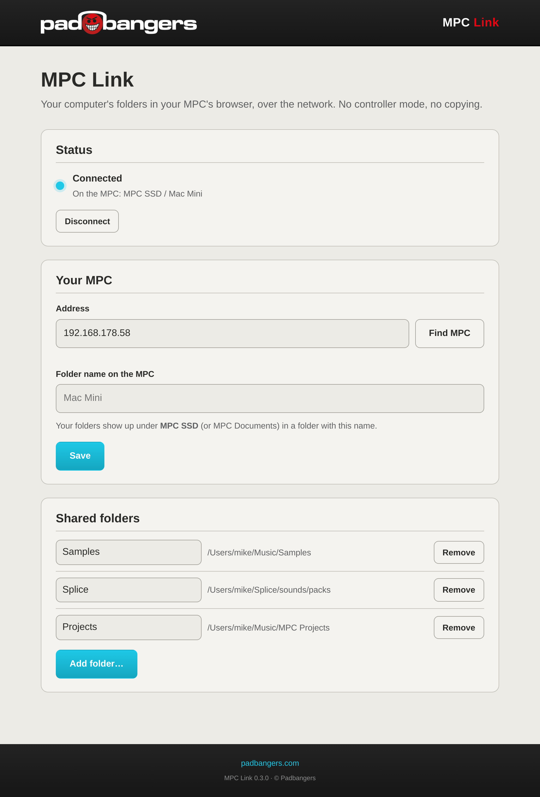
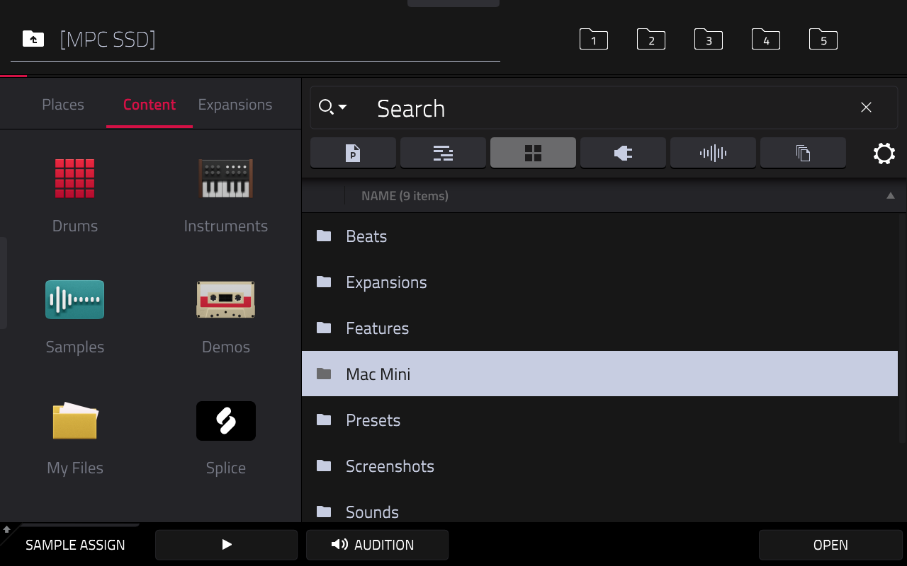

# MPC Link

**MPC Link** by [Padbangers](https://padbangers.com) puts folders from your Mac or PC into your **Akai MPC's browser**,
over your home network. Load samples straight from your computer, save projects back to it: no controller mode, no
copying, no USB stick.



On the MPC your folders show up like any other folder, on the drive you choose: for example
**MPC SSD → *your computer's name* → Samples, Projects, …**, an SD card or USB drive, or the internal storage
(**Internal → MPC Documents → *your computer's name***). Everything you load comes from the computer, everything you save
there lands on the computer.



*The MPC's browser on the SSD: "Mac Mini" is the computer's folder, with its shared folders inside.*

## What you need

- A standalone MPC with **root SSH access**: a modded MPC running the **Hakai** firmware,
  which lets you log in as `root` without a password. Stock MPC OS does not allow this.
  Developed and tested on an **MPC X** with MPC OS 3.9.1; the other first-generation devices (MPC Live / Live II,
  One, Key 61, Force) run the same system and should work the same way.
- Your computer and the MPC on the **same network** (Wi-Fi or cable).
- **macOS 11** or newer (Apple Silicon or Intel), or **Windows 10/11** (64-bit, Intel/AMD or ARM).

Nothing is installed permanently on the MPC except one small program (`/data/hacks/link/sshfs`, 1 MB) that MPC Link
copies there the first time it connects. The MPC's firmware is not touched.

## Install

### macOS

1. Download `MPC-Link-<version>-macOS.zip` from [Releases](../../releases) and unzip it.
2. Drag **MPC Link** into your **Applications** folder.
3. Open it. The app isn't signed by Apple, so the first time macOS says it can't check it: **right-click the app →
   Open → Open** (or System Settings → Privacy & Security → *Open Anyway*).
4. If macOS asks whether MPC Link may find devices on your local network, click **Allow**.

MPC Link lives in the **menu bar** (the MPC icon), not in the Dock.

### Windows

1. Download `MPC-Link-<version>-windows-amd64.exe` (most PCs) or `…-arm64.exe` (Windows on ARM) from
   [Releases](../../releases). Put it somewhere permanent, e.g. a folder in *Documents*.
2. Start it. The file isn't signed, so Windows SmartScreen may warn: **More info → Run anyway**.
3. If the Windows firewall asks, allow it on **private** networks.

MPC Link lives in the **tray** (bottom right, maybe behind the `^` arrow).

## Set it up

The first time, the settings page opens in your browser by itself. Later you open it from the menu bar / tray icon:
**Settings…**

1. **Your MPC → Find MPC.** MPC Link searches your network and lists the MPCs it finds. Click yours, then **Save**.
   (Or type the MPC's address yourself: on the MPC under *Preferences → Network*, or in your router.)
2. **Drive on the MPC**: where your folders show up. **Automatic** uses an SSD, SD card or USB drive in the MPC if
   there is one, else the internal storage; or pick **Internal** or a drive by its name. MPC Link finds the MPC's
   drives by itself, whatever they're called; one you plug in shows up in the list within about 20 seconds.
   If the chosen drive isn't in the MPC, MPC Link waits for it and says so in the status.
3. **Folder name on the MPC** (optional): the name of your computer's folder on that drive. Empty = your computer's name.
4. **Shared folders → Add folder…** and pick the folders you want on the MPC: your sample library, a Splice folder,
   a projects folder. You can rename each one (the name the MPC shows) or remove it.

A few seconds later the status turns **Connected** and the folders are on the MPC. That's it: from now on MPC Link
connects by itself whenever the MPC is on the network.

## Use it on the MPC

Open the MPC's **browser** and go to **MPC SSD → *your computer's name***. Preview, load and drag samples as usual;
save projects or samples into one of these folders and they're written straight to your computer.

- A folder you add on the computer shows up on the MPC within seconds (open the folder again if it's already open).
- Files you change on the computer are seen by the MPC the next time it reads them.
- If the computer goes to sleep, the network drops or you quit MPC Link, the folder disappears from the MPC. It comes
  back by itself when the connection is there again.
- Projects that reference samples in these folders need the folder there when you load them, just like a USB drive.
- **Ejecting a drive** on the MPC that holds MPC Link's folder: choose **Disconnect** in MPC Link first (or pick
  another drive), so the drive isn't busy.

## The menu bar / tray icon

| | |
|---|---|
| Icon solid / faded | connected / not connected |
| **Settings…** | the settings page |
| **Disconnect / Connect** | remove the folders from the MPC, or bring them back |
| **Quit MPC Link** | removes the folders from the MPC and quits |

## Start at login

- **macOS:** System Settings → General → **Login Items** → *Open at Login* → **+** → MPC Link.
- **Windows:** press `Win + R`, type `shell:startup`, Enter, and put a shortcut to the MPC Link `.exe` in that folder.

## Troubleshooting

- **"Find MPC" finds nothing.** Is the MPC switched on and on the same network as the computer (not a guest network)?
  Does `ssh root@<MPC address>` work from a terminal? Without root SSH (Hakai) MPC Link can't connect.
- **"Not connected: … i/o timeout".** The MPC isn't reachable at that address: its address may have changed (set a
  fixed address for it in your router), or it's asleep. MPC Link keeps trying by itself.
- **"the MPC's SSH host key changed".** Another device now has the MPC's address, or the MPC was reinstalled. If you
  know it's your MPC, set the address again in the settings and **Save**: MPC Link learns the new key.
- **macOS: connected in the terminal but not as an app.** Check System Settings → Privacy & Security →
  **Local Network** → MPC Link is on.
- **The folder doesn't show on the MPC.** Leave the folder in the MPC's browser and open it again; the MPC lists a
  folder's contents when you open it.

## Security

MPC Link logs in to the MPC as `root`, the way the Hakai firmware allows: **with no password**. Anyone on your network
can do the same with or without MPC Link, so keep the MPC on networks you trust (your home, your studio).
MPC Link only shares the folders you add; nothing else on your computer can be reached from the MPC. The settings page
is only reachable from your own computer.

## How it works

MPC Link connects to the MPC over SSH (the MPC is the server, so your computer needs no SSH server and no open port).
On the MPC it runs [SSHFS](https://github.com/libfuse/sshfs) in *passive* mode: SSHFS mounts a folder and speaks SFTP
over that same SSH connection, and MPC Link answers with a small SFTP server that only sees your shared folders. The
MPC's browser lists only drives its own disk service (`edisksd`) mounted, but shows every folder on them, so the mount
point is a folder on one of those drives (or in the internal MPC Documents). MPC Link finds the drives in the MPC's
mount table (the ones `edisksd` mounted) and checks them again every 20 seconds. macOS metadata files (`._*`, `.DS_Store`) are hidden from the MPC.

## Remove it

Quit MPC Link and delete the app. On the MPC, to remove the helper too: `ssh root@<MPC address> rm -rf /data/hacks/link`.
The settings are in `~/Library/Application Support/MPC Link` (macOS) or `%AppData%\MPC Link` (Windows).

## Build from source

Needs Go 1.23 or newer (macOS builds need the Xcode command line tools for the menu bar code).

```sh
git clone https://github.com/FullPace/mpc-link && cd mpc-link
./scripts/make-mac-app.sh     # -> build/MPC Link.app (universal)
./scripts/make-windows.sh     # -> build/MPC Link-amd64.exe, build/MPC Link-arm64.exe
go run ./cmd/mpc-link -headless -host <MPC address> -share "Samples=/path/to/samples"   # terminal mode
```

The SSHFS binary for the MPC is in `device/` (how to rebuild it: [`device/README.md`](device/README.md)); the icons are
rendered from `assets/SVG/` by `assets/render.py`.

## Licenses

- MPC Link: MIT, see [`LICENSE`](LICENSE).
- SSHFS (copied to the MPC as a separate program): GPL-2.0, with libfuse and GLib; source and details in
  [`device/README.md`](device/README.md).
- Go libraries: [golang.org/x/crypto](https://pkg.go.dev/golang.org/x/crypto) (BSD-3-Clause),
  [pkg/sftp](https://github.com/pkg/sftp) (BSD-2-Clause), [fyne.io/systray](https://github.com/fyne-io/systray)
  (Apache-2.0).
- Not affiliated with Akai Professional or inMusic. MPC is a trademark of inMusic Brands.
